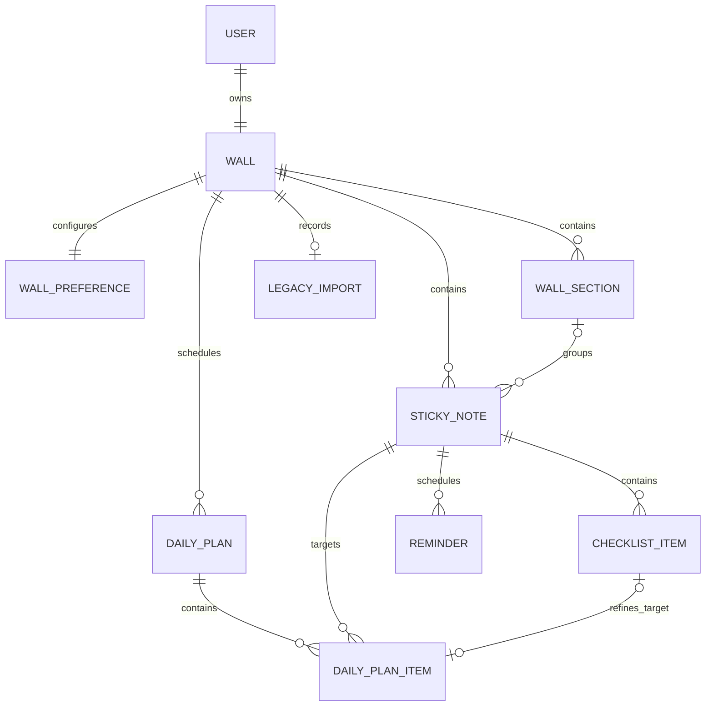

# WALLFLOW backend architecture

Milestone 10 design proposal. The frontend audit below describes the current implementation. The schema, API and deployment sections describe the proposed backend.

## 1. Frontend data audit

The React application renders the wall and notes in Three.js. Zustand owns the wall document and preferences. The camera, textures, geometry, hit testing and drag animations are client-side concerns. The repository has no account, server wall ID, record timestamps, network persistence or cross-device synchronization.

### Persistent models

These names and fields come from [wall.ts](../../src/types/wall.ts) and the [Zustand store](../../src/stores/wallStore.ts). A question mark marks a TypeScript optional property.

| Current type or field | Exact stored shape and semantics |
| --- | --- |
| `Point2` | `[number, number]`. Used for positions, note dimensions and wall rotation. |
| `WallDocument` | `notes: StickyNoteData[]`, `sections: WallSection[]`, `wallRotation: Point2`. It is also the undo snapshot shape. Wall rotation is `[tilt, turn]` in degrees, clamped to ±25° and ±30° respectively. |
| `StickyNoteData` | `id: string`, `title: string`, `body: string`, `color: NoteColor`, `position: Point2`, `rotation: number`, `typography?: NoteTypography`, `size?: Point2`, `doodle?: 'spark' \| 'flower' \| 'leaf'`, `archived?: boolean`, `sectionId?: string`, `plannedOn?: string`, `reminder?: NoteReminder`. It extends `NoteTaskFields`. |
| `NoteTaskFields` | `checklist?: ChecklistItem[]`, `priority?: TaskPriority`, `dueDate?: string`, `completed?: boolean`. Priority is `low`, `medium` or `high`. |
| Note placement and appearance | `position` is a wall-local `[x, y]` center. In-plane `rotation` is radians. Paper depth is derived from the index in the full notes array. Higher indices draw closer to the viewer. `size` is `[width, height]` in scene units and defaults to `[2.62, 2.78]` when omitted. `NoteColor` is `yellow`, `pink`, `green`, `blue` or `violet`. `NoteTypography` is `handwritten` or `sans`, with handwritten used when omitted. |
| `ChecklistItem` | `id: string`, `text: string`, `done: boolean`, `plannedOn?: string`. Array order is the display order. IDs are checked for uniqueness within each note at hydration. |
| `WallSection` | `id: string`, `name: string`, `position: Point2`. A note may keep an explicitly assigned `sectionId` outside that region. A note move or resize that supplies a changed center resolves membership spatially. Clamping on a rotation alone does not recalculate membership. Creation and movement of a section can recalculate affected active notes. The preferred containing section wins, otherwise the closest wins, with array order breaking ties. The region size is fixed at 7.4 × 5.6 scene units. Section deletion clears membership. |
| Daily planning | The note and each checklist item independently carry one optional `plannedOn` day. Both `plannedOn` and `dueDate` are civil `YYYY-MM-DD` dates. Replanning a target replaces its old day. A whole note and its checklist items can be planned separately, and planning leaves the due date alone. |
| `NoteReminder` and `notifiedReminders` | A note holds one optional `{ id: string, at: number }`, with `at` an integer Unix millisecond instant. Changing the time creates a new ID. `notifiedReminders: string[]` records reminder IDs whose browser notification constructor succeeded. Receipts contain no timestamp or device ID and establish no OS display guarantee. |
| Wall name and lighting | `wallName: string` defaults to `My everyday wall`. `lighting: Lighting` is the separate legacy `daylight` or `warm` preference, default `daylight`. |
| `WallAppearance` | `theme: EnvironmentTheme` is `minimal`, `study`, `studio` or `lab`. `shade: WallShade` is `theme`, `chalk`, `ivory` or `mist`. `intensity: number` is normalized to 85–115. `ambience: EnvironmentAmbience` is `theme`, `quiet` or `airy`. Defaults are `minimal`, `theme`, `100`, `theme`. |
| `NoteDefaults` | `color: NoteColor`, `typography: NoteTypography`, `size: NewNoteSize` (`compact`, `standard`, `large`), `rotation: NewNoteRotation` (`varied`, `straight`). Defaults are yellow, handwritten, standard and varied. Defaults apply at creation. Preset scale factors are 0.78, 1 and 1.3. |
| Onboarding and hints | `onboardingComplete: boolean` and `showHints: boolean`, initially false and true. `FirstWallOptions` is an action argument with `starter: 'samples' \| 'blank'`, optional `theme`, `color` and `offerTutorial`. Blank setup removes unchanged starter notes only. A saved object missing `onboardingComplete` is treated as returning, including records that carry the historical `welcomeDismissed` field. |

Layout and state sources are [wallSections.ts](../../src/utils/wallSections.ts), [noteDimensions.ts](../../src/utils/noteDimensions.ts), [Wall.tsx](../../src/components/wall/Wall.tsx), [appearance.ts](../../src/utils/appearance.ts), [dailyPlan.ts](../../src/utils/dailyPlan.ts), [reminders.ts](../../src/utils/reminders.ts) and [onboarding.ts](../../src/utils/onboarding.ts).

### Derived and session-only data

| Classification | Current behavior |
| --- | --- |
| Derived | Today and overdue lists, daily progress, checklist and completion summaries, reminder countdowns, note depth, section bounds, current camera framing, search results and filter matches. Today includes due-today notes, incomplete overdue notes, planned notes or checklist items, and incomplete notes with reminders falling on the device-local day. Archived notes are excluded from Today and progress. Progress reads current note `completed` and checklist `done`, counting whole notes and planned checklist items separately. Reminders are listed for active incomplete notes. |
| History | `past: WallDocument[]` and `future: WallDocument[]`, with up to 50 previous snapshots. Notes, sections and wall tilt/turn participate. Preferences, wall name and notification receipts are outside undo snapshots. New and existing editors keep an `editSession` until done. Ordinary note removal is undoable. Permanent deletion of an archived note removes it from history. Receipts for undoable reminders are retained in memory and matched to current notes on reload. |
| Session UI | `selectedId`, `editingId`, `editSession`, `showTaskDetails`, `draggingId`, `draggingFromTouch`, `mode` (`select`, `pan`, `orbit`), `searchOpen`, `settingsOpen`, `helpOpen`, `tasksOpen`, `archiveFocusId`, `filters`, `today`, `reminderPermission`, `zoomPercent`, `zoomBounds` and `cameraCommand`. `cameraCommand` is `{ kind: CameraKind, value?: number, targetId?: string, nonce: number } | null` where the kinds are `reset`, `zoom`, `focus` and `section`. `today` is seeded from the browser and changes as local time advances. |
| Tutorial and browser state | `TutorialProgress = 'invite' \| number \| null`. The step, invitation and completion of the walkthrough are transient. Starting the tutorial for an already-onboarded user changes only transient state. Notification permission belongs to the browser. The scheduler uses timers and recovers on wake or visibility changes within an open application. |

`WallFilters` holds `priority` (`any`, `none` or a priority), `completion` (`any`, `open`, `completed`), `due` (`any`, `none`, `today`, `overdue`, `upcoming`), `section: string | null` (empty string is unassigned and null is any section) and `archive` (`active`, `archived`, `all`). The search query and current tasks tab are UI state. Search splits lower-cased terms on whitespace and requires every term to occur in the title, body or checklist text.

See [wallStore.ts](../../src/stores/wallStore.ts), [dailyPlan.ts](../../src/utils/dailyPlan.ts), [noteSearch.ts](../../src/utils/noteSearch.ts), [useReminderScheduler.ts](../../src/hooks/useReminderScheduler.ts) and [taskDates.ts](../../src/utils/taskDates.ts).

### Current storage and validation

- Zustand persists `{ state, version: 1 }` to `localStorage['wallflow-wall-v1']`. `SavedWall` selects exactly `notes`, `sections`, `wallRotation`, `wallName`, `lighting`, `appearance`, `noteDefaults`, `showHints`, `onboardingComplete` and `notifiedReminders`. It uses a custom merge and has no explicit Zustand `migrate` callback. The storage wrapper skips identical writes, catches browser storage failures and emits `wallflow-storage-error`. [Store](../../src/stores/wallStore.ts) · [Storage adapter](../../src/utils/storage.ts)
- Hydration validates finite two-element tuples and rotations, deduplicates IDs by entity scope, discards invalid enum/optional fields, trims wall and section names and prunes unknown section references and unrelated reminder receipts. An explicit empty note array survives. A nonempty array whose entries are all dropped can fall back to starter notes. Import must avoid that fallback for malformed input. User-generated IDs use UUIDs, while starter note IDs are fixed strings and validators accept legacy nonempty strings. Reminder IDs have a 100-unit limit and duplicate reminder IDs across notes are discarded during hydration. [Store](../../src/stores/wallStore.ts) · [Starter notes](../../src/utils/constants.ts)
- Caps are 60 active notes, 24 sections and 24 items per checklist. The active limit excludes archived notes. Text limits are title 72, body 240, checklist text 120, section name 40 and wall name 48 JavaScript UTF-16 code units. Existing empty note text and empty edited checklist text are valid. The wall is 32 × 22 scene units. Requested note dimensions normalize to 65–220% of each base dimension and note centers clamp to the resulting rotated footprint plus margins. Section centers clamp to x ±12.15 and y ±8.05. [Constants](../../src/utils/constants.ts) · [Note dimensions](../../src/utils/noteDimensions.ts) · [Sections](../../src/utils/wallSections.ts) · [Checklist validation](../../src/utils/noteTasks.ts)
- Date strings represent calendar days in years 0001–9999. Reminder times accept safe integer milliseconds from `-62135596800000` to `253402300799999`. The editor interprets its local input in the device timezone and rejects nonexistent local times such as a daylight-saving gap. Storage does not record an IANA timezone or original offset. [Date helpers](../../src/utils/taskDates.ts) · [Reminder helpers](../../src/utils/reminders.ts)

## 2. System architecture

Serve React and `/api/v1/` from one origin. React owns interactions and rendering. Django owns Google sign-in, sessions, API validation and transactions. PostgreSQL is the authoritative store for the account wall. Mount the workspace only after the session check succeeds. Fetch a protected wall snapshot before creating account-scoped state. Keep access to the legacy key in a dedicated read-only importer.

| Proposed module | Responsibility |
| --- | --- |
| `backend/config/` | Django settings for local/test/production, root URL configuration and WSGI entry point. |
| `backend/accounts/` | Custom Google-backed user, OAuth/OIDC views, provider integration and session lifecycle. |
| `backend/walls/` | Wall, notes, sections, task data, preferences and legacy import models. Service modules handle transactions, membership, version checks and imports. |
| `backend/walls/api/` | DRF serializers, versioned routes, field validation, owned querysets and response projections. |
| Existing React frontend | A small typed HTTP adapter maps DTOs into the existing Zustand model. Camera, pointers, animations, note textures and session UI stay in the client. |

Recommend Django 5.2 LTS, a compatible DRF release, Psycopg 3 and PostgreSQL 17, pinned to maintained patch versions at implementation time. Use `USE_TZ=True` and UTC for server timestamps. Use Django's custom user model from the first migration and database-backed Django sessions. Use DRF session authentication for wall APIs. Resolve the wall through `request.user` and scope each queryset to that wall before ID lookup. Nested requests must match their parent as well. Use composite database keys for same-wall references, transaction locks for quotas and wall revision, and domain-service tests against PostgreSQL. [Django custom users](https://docs.djangoproject.com/en/5.2/topics/auth/customizing/) · [Django sessions](https://docs.djangoproject.com/en/5.2/topics/http/sessions/) · [DRF permissions](https://www.django-rest-framework.org/api-guide/permissions/)

## 3. Relational PostgreSQL schema

Use UUID primary keys, required fields unless marked nullable, and server-generated `created_at` and `updated_at` of type `timestamptz` for mutable records. Keep update timestamps in services for bulk writes. Defaults apply only to new rows and explicit import normalization. `DATE` is for civil due and planning days. `timestamptz` represents a reminder or audit instant, exposed as RFC 3339 with an offset, canonicalized to UTC on output. UUID foreign refs are checked within the same wall even when IDs are globally unique.

| Model | Fields beyond `id` and common timestamps | Constraints and deletion |
| --- | --- | --- |
| `User` | `google_sub varchar(255)`, nullable `email varchar(254)` and `display_name varchar(150)` for profile display, `last_login timestamptz NULL`, Django `password varchar(128)` set unusable, `is_active`, `is_staff`, `is_superuser` booleans. | `UNIQUE (google_sub)`. Case-sensitive stable Google subject on a Google-only table. Profile fields can change and can be shared by accounts. Google login grants no staff privileges. User erasure cascades to the owned wall. The account erasure workflow also revokes sessions. |
| `Wall` | `owner_id uuid`, `name varchar(48)`, `tilt_deg`, `turn_deg` as `double precision`, `revision bigint DEFAULT 0`, `next_note_order bigint`, `next_section_order bigint`. | `owner_id UNIQUE NOT NULL REFERENCES user ON DELETE CASCADE`. Angles finite within the existing ranges, positive sequence counters and nonnegative revision. Lock the row for a write, use monotonic order values for appends and increment revision once per visible change. |
| `WallSection` | `wall_id uuid`, `name varchar(40)`, `x`, `y` as `double precision`, `sort_index bigint`. | Wall deletion cascades. Unique `(wall_id,id)`, `(wall_id,sort_index)`. Positions finite and bounded. Names may repeat. Deletion clears note membership, including archived and deleted notes. |
| `StickyNote` | `wall_id uuid`, `section_id uuid NULL`, `title varchar(72)`, `body varchar(240)`, `color varchar(8)`, `typography varchar(12) NULL`, `doodle varchar(8) NULL`, `x`, `y`, `rotation_rad`, `width`, `height` as `double precision` with nullable dimensions, `sort_index bigint`, `priority varchar(6) NULL`, `due_date date NULL`, `completed boolean DEFAULT false`, `archived boolean DEFAULT false`, `deleted_at timestamptz NULL`. | Unique `(wall_id,id)`, `(wall_id,sort_index)`. Dimensions are jointly null or in range. Check finite geometry, enum domains and wall bounds. `(wall_id,section_id)` refers to a section of the same wall. Wall or permanent note deletion cascades to child data. `deleted_at` is a proposed reversible state for ordinary Delete and its Undo. Archive is a separate recoverable state. |
| `ChecklistItem` | `wall_id uuid`, `note_id uuid`, `text varchar(120)`, `done boolean DEFAULT false`, `sort_index smallint` (0–23). | Unique `(wall_id,note_id,id)`, `(note_id,sort_index)`. Reordering can defer the order uniqueness check to transaction commit. Composite note FK cascades when its note is permanently deleted. |
| `DailyPlan` | `wall_id uuid`, `day date`. | Unique `(wall_id,day)` and `(wall_id,id)`. Wall deletion cascades. Create on first addition. A read for an absent day returns an empty projection. |
| `DailyPlanItem` | `wall_id uuid`, `plan_id uuid`, `note_id uuid`, `checklist_item_id uuid NULL`. | Composite refs `(wall_id,plan_id)`, `(wall_id,note_id)` and `(wall_id,note_id,checklist_item_id)` require the same wall and, for a checklist target, the same parent note. Null checklist ID means whole note. Partial uniques on `(wall_id,note_id) WHERE checklist_item_id IS NULL` and `(wall_id,checklist_item_id) WHERE checklist_item_id IS NOT NULL` enforce one day per target across all plans. Physical parent or checklist deletion cascades. Completion reads the target row. |
| `Reminder` | `wall_id uuid`, `note_id uuid`, `at timestamptz`, `cancelled_at timestamptz NULL`, `browser_notified boolean DEFAULT false`, `browser_ack_at timestamptz NULL`. | Composite note FK with cascade and partial unique `(note_id) WHERE cancelled_at IS NULL`. The ID represents an occurrence. A schedule edit retires the occurrence and creates a fresh one. True `browser_notified` with null `browser_ack_at` represents an imported receipt of unknown time. A non-null ack time implies the flag is true. |
| `WallPreference` | `wall_id uuid PRIMARY KEY` in place of `id`, `theme varchar(8)`, `wall_shade varchar(8)`, `light_intensity smallint`, `ambience varchar(8)`, `lighting varchar(8)`, `default_note_color varchar(8)`, `default_note_typography varchar(12)`, `default_note_size varchar(8)`, `default_note_rotation varchar(8)`, `show_hints boolean`, `onboarding_complete boolean`. | Wall deletion cascades. Check enum and range values. Defaults match the frontend. Create alongside an empty wall in the account provisioning transaction. |
| `LegacyImport` | `wall_id uuid`, `idempotency_key uuid`, `source_version smallint`, `source_sha256 char(64)`, `applied_revision bigint`, integer counts for notes, sections, checklist items, plan entries and reminders, `created_at timestamptz`. | Unique wall and `(wall_id,idempotency_key)`. Durable atomic receipt for a one-time merge-free import. Wall deletion cascades. Store the digest and counts without retaining a duplicate note payload. |

Use `CHECK` constraints for value domains, civil ranges, geometry and known enums. PostgreSQL character length differs from JavaScript UTF-16 length, so enforce compatibility in serializers and the importer. Preserve order gaps on archive or deletion so the front-to-back overlap order remains stable. For section removal use PostgreSQL's composite FK with `ON DELETE SET NULL (section_id)`, leaving `wall_id` intact. Django's relationship declarations are insufficient to enforce the composite ownership refs or the database-level delete actions by themselves. Add those constraints explicitly when implementing the schema, and keep deletion services and Django model behavior aligned. Skip active-list, Today and reminder projections for reversible deletions. Retain those child rows so Undo can recover the original record. Permanent deletion requires an archived note and physically removes it and its dependent rows. [PostgreSQL constraints](https://www.postgresql.org/docs/17/ddl-constraints.html) · [Django foreign keys](https://docs.djangoproject.com/en/5.2/ref/models/fields/#foreignkey)

Start with the note `(wall_id, sort_index)` unique index, an archived partial index `(wall_id, sort_index) WHERE archived AND deleted_at IS NULL`, section membership `(wall_id, section_id)`, open due tasks `(wall_id, due_date) WHERE NOT archived AND NOT completed AND deleted_at IS NULL AND due_date IS NOT NULL`, plan items `(wall_id, plan_id)` and current reminders `(wall_id, at) WHERE cancelled_at IS NULL`. Index additional referencing columns where the unique or other indexes do not already cover deletes and joins. Keep active search client-side at 60 notes. Start archive search with bounded owner-scoped queries and add a text index only after measuring. Apply the active-note and section limits under the wall lock. Checklist order and range constraints enforce its cap as well.

`LegacyImport` is justified by retry safety without retaining raw snapshots. Django sessions cover login handshakes and authenticated sessions. Google identity fits on `User` while Google is the sole provider. A separate identity, device or notification delivery table can wait for a concrete requirement. None of the wall domain columns require JSONB.



A whole note can have one whole-note plan entry across all days plus entries targeting its individual checklist items. A note may have multiple historical reminders with at most one current reminder.

## 4. Google sign-in and session lifecycle

Use the server-side OAuth 2.0 authorization code flow with OpenID Connect and PKCE S256. A vetted OIDC client should handle discovery, token exchange and signature verification using Google's trusted metadata. Use a Google Web application client with exact callback URIs and the `openid email profile` scopes. Google profile and verified email can populate display metadata. Identify accounts solely by Google's stable, case-sensitive `sub`. Never link accounts by email. Keep authorization codes, Google tokens and the client secret out of React and avoid requesting offline Google access. [Google OIDC guide](https://developers.google.com/identity/openid-connect/openid-connect) · [Google OIDC reference](https://developers.google.com/identity/openid-connect/reference) · [OAuth security best current practice](https://www.rfc-editor.org/rfc/rfc9700.html)

1. React loads the sign-in shell and checks `GET /api/v1/auth/me/`. A valid session unlocks the workspace. To start sign-in, React requests `GET /api/v1/auth/csrf/` and receives a masked CSRF token.
2. A user click submits a top-level form POST to `/api/v1/auth/google/start/` with the CSRF form field. A Django view explicitly checks CSRF even for an anonymous session. It creates a short-lived one-time attempt (10 minutes) in the server-side session with a cryptographically random state, nonce, PKCE verifier and fixed return route. It returns a 303 redirect to Google with the code challenge and OIDC parameters.
3. Google redirects the browser to `/api/v1/auth/google/callback/` with `code` and `state` or a denial response. Django checks the attempt's session, state and age and atomically consumes the matching attempt before any token call. Lock and reload the session row for this step so concurrent callbacks cannot both succeed. Release the lock before the network call. Keep one active attempt per session and reject stale, unbound and replayed callbacks.
4. Django exchanges the code directly with Google using the verifier and original redirect URI. Verify the ID token signature using Google's rotating JWKS, allowed issuer, audience, authorized party when applicable, expiry, issue time, nonce and valid `sub`. Enforce a small clock-skew tolerance and bounded provider timeouts. Reject invalid responses and discard the provider tokens after use.
5. Provision the user, empty primary wall and preferences atomically on first login. Handle simultaneous first logins using the unique subject and owner constraints. Existing active users keep the same wall. Django `login()` cycles the anonymous session key or flushes a session for another account, and rotates the CSRF secret. Redirect to fixed `/app/`. On errors, redirect to a fixed sign-in route with a bounded reason such as `expired`, `denied`, `invalid` or `unavailable`. Prevent redirect injection and avoid echoing provider messages.
6. React fetches the current user and a fresh CSRF token. Send `X-CSRFToken` on unsafe same-origin API calls. Logout is an authenticated CSRF-protected POST that flushes the Django session. React clears all account state, pending writes and reminder timers on logout or account change. Expired or disabled accounts return to sign-in. [Django CSRF](https://docs.djangoproject.com/en/5.2/howto/csrf/) · [DRF session authentication](https://www.django-rest-framework.org/api-guide/authentication/#sessionauthentication)

In production, use host-only cookies with `Path=/`, `Secure`, `HttpOnly` and `SameSite=Lax`. Lax permits the session cookie on Google's top-level GET callback. Prefer `__Host-` names over TLS. Make the CSRF cookie HttpOnly and use Django's masked token bootstrap response so React can keep the token in memory. Send `Cache-Control: no-store` on auth responses and `Referrer-Policy: no-referrer` on callback redirects. Start with a proposed 14-day absolute session expiry, keep handshakes much shorter, and routinely clear expired Django sessions. Use plain local cookie names and disable Secure only for loopback development settings. [Django sessions](https://docs.djangoproject.com/en/5.2/topics/http/sessions/) · [Deployment checklist](https://docs.djangoproject.com/en/5.2/howto/deployment/checklist/)

## 5. API specification

All paths below are relative to `/api/v1`. The examples use `N`, `S`, `C`, `I`, `R` and `W` as placeholders for note, section, checklist, plan-item, reminder and wall UUIDs. JSON examples show the contract, including abbreviated projections where named. Writes use camelCase. The adapter converts nullable fields to omitted TS optionals where needed, maps timestamps to epoch milliseconds, and maps plan memberships to `plannedOn`. Coordinates and degrees/radians keep their current units.

### Shared API rules

- Every wall read and write requires a valid session. Resolve the current user's primary wall server-side. Accept no owner or wall overrides. Use wall-scoped queries through every nested path and referenced ID. Return the same `404 not_found` for absent or foreign resources, including foreign nested targets. The tables list operation-specific errors in addition to these shared rules.
- Every unsafe request requires CSRF, including a reminder acknowledgement and the import preview. Every wall mutation except the monotonic reminder acknowledgement also requires the wall-wide `If-Match: "wall:W:3"` obtained from `ETag`. Lock the wall row first, check the precondition, mutate atomically and increment revision once for a meaningful state change. Return the resulting ETag on wall reads and successful writes. Multi-query reads use a consistent PostgreSQL read snapshot so the payload and tag describe the same revision. Client reads use `Cache-Control: private, no-store`.
- Use `400 invalid_data` for malformed JSON, invalid fields or unsupported query values, `403 auth_required` for a missing Django session, `403 csrf_failed` for unsafe requests that fail CSRF, `409` for domain conflicts, `412 stale_wall` for revision mismatch, `428 precondition_required` for a missing required match, `429 rate_limited` with `Retry-After`, and `503 unavailable` for transient outages. Auth redirect failures use the sign-in reason instead of the JSON envelope. Configure separate CSRF failure handling for Django's anonymous POST.
- Return stable error codes and field paths, for example `{"error":{"code":"invalid_data","message":"Check the submitted fields.","fields":{"size":["Provide two finite dimensions."]}}}`. Validate strict types, finite numbers, allowed fields, text lengths, enum values, day bounds, explicit reminder offsets, millisecond precision and request size. Return sanitized server errors without stack traces.

### Authentication

| Method and URL | Example request and success response | Authentication, ownership and specific errors |
| --- | --- | --- |
| `GET /auth/csrf/` | No body → 200 `{"csrfToken":"masked-token"}` plus CSRF cookie. | Public, same-origin bootstrap. 429 on abuse. |
| `POST /auth/google/start/` | Form `csrfmiddlewaretoken=masked-token` → 303 to Google authorization endpoint. | Public with CSRF. Establishes the initiating session. 403 CSRF, 429 throttle or 503 provider configuration unavailable. |
| `GET /auth/google/callback/?code=...&state=...` | No body → 303 `/app/` plus rotated session cookie. | Public entry point bound to the initiating session and valid Google identity. Invalid, denied, expired and unavailable outcomes redirect to sign-in. |
| `GET /auth/me/` | No body → 200 `{"id":"user-uuid","displayName":"Asha","email":"asha@example.test"}`. | Session required. Reads the authenticated user only. 403 for absent or invalid session. |
| `POST /auth/logout/` | No body, `X-CSRFToken` → 204 with an expired session cookie. | Session and CSRF required. Flushes the current session. 403 for an invalid session or CSRF. |

### Wall, notes, sections and checklist

The wall snapshot bundles the bounded active workspace and preferences. A page fetches archived records only when needed. Checklist items carry `plannedOn` on reads and are ordered by `sort_index`. A live reminder projection contains its occurrence ID, UTC time and browser acknowledgement flag. Use a numeric `order` for stable note stacking and section tie breaks. Also supply a zero-based `layerIndex` for notes, computed over active and archived rows sorted by that order, excluding reversible deletes. The renderer can feed this ordinal into the current depth formula even when archive pages are loaded separately. Use safe integers for counters exposed to React. Test overlap and pickup with interleaved archives. [Current depth formula](../../src/three/noteLayers.ts)

```json
{
  "id": "W",
  "revision": 3,
  "wallName": "My everyday wall",
  "wallRotation": [0, 0],
  "sections": [{"id": "S", "name": "Research", "position": [4, 2], "order": 1}],
  "notes": [{
    "id": "N",
    "title": "Read research paper",
    "body": "Review methods.\nSave questions.",
    "color": "yellow",
    "typography": null,
    "position": [4, 2],
    "rotation": -0.04,
    "size": null,
    "doodle": null,
    "order": 1,
    "layerIndex": 0,
    "sectionId": "S",
    "checklist": [{"id": "C", "text": "Open paper", "done": false, "plannedOn": "2026-11-25"}],
    "priority": "medium",
    "dueDate": "2026-11-25",
    "completed": false,
    "archived": false,
    "deleted": false,
    "plannedOn": null,
    "reminder": {"id": "R", "at": "2026-11-25T11:00:00.000Z", "browserNotified": false}
  }],
  "preferences": {
    "lighting": "daylight",
    "appearance": {"theme": "minimal", "shade": "theme", "intensity": 100, "ambience": "theme"},
    "noteDefaults": {"color": "yellow", "typography": "handwritten", "size": "standard", "rotation": "varied"},
    "showHints": true,
    "onboardingComplete": true
  }
}
```

| Method and URL | Example request and success response | Session ownership and specific errors |
| --- | --- | --- |
| `GET /wall/` | No body → 200 wall snapshot above. | Read the session's primary wall. 404 if provisioning is incomplete. |
| `PATCH /wall/` | `{"wallName":"Research wall","wallRotation":[8,-5]}` → 200 wall metadata, for example `{"id":"W","revision":4,"wallName":"Research wall","wallRotation":[8,-5]}`. | Same primary wall. 400 for invalid name or angles. |
| `GET /wall/notes/?scope=archived&limit=25&q=paper` | No body → 200 `{"items":[],"nextCursor":null}`. | Scope to the primary wall. Query supports `active`, `archived` or `all` and bounded cursor pagination. Optional filters mirror `priority`, `completion`, `due` and `section` in the store. Require a civil `day` for relative due filters. Reversible deletions are excluded. 400 bad query/cursor, 409 `cursor_stale` after changes invalidate a page sequence. |
| `POST /wall/notes/` | `{"id":"N","title":"Read paper","body":"","color":"yellow","position":[4,2],"rotation":-0.04}` → 201 note projection. | Create on the primary wall and validate any supplied section. 409 `active_limit` or generic `id_conflict` on reused UUID. |
| `GET /wall/notes/{noteId}/` | No body → 200 note projection, including `archived` and `deleted`. | Match the note to this wall. 404 for a missing or foreign note. |
| `PATCH /wall/notes/{noteId}/` | `{"position":[5,3],"size":[3,3]}` or `{"archived":true}` or `{"deleted":false}` → 200 updated note projection. | Match note and any referenced section to the wall. 400 invalid geometry or lifecycle payload, 409 `active_limit` on restore or `invalid_state` for incompatible edits. |
| `DELETE /wall/notes/{noteId}/` | No body → 204, empty body. | Match note to this wall. Permanent deletion of an archived note only, after UI confirmation. 409 `archive_required` otherwise. |
| `POST /wall/sections/` | `{"id":"S","name":"Research","position":[4,2]}` → 201 `{"section":{"id":"S","name":"Research","position":[4,2],"order":1},"membershipChanges":[{"noteId":"N","sectionId":"S"}]}`. | Create on the primary wall and derive affected memberships there. 409 `section_limit` or `id_conflict`. |
| `PATCH /wall/sections/{sectionId}/` | `{"position":[5,3]}` → 200 with updated `section` and `membershipChanges` as above. | Match section to this wall. 400 invalid name/position. |
| `DELETE /wall/sections/{sectionId}/` | No body → 200 `{"id":"S","membershipChanges":[{"noteId":"N","sectionId":null}]}`. | Match section to this wall. Clears memberships and preserves the notes. 404 for missing or foreign section. |
| `PUT /wall/notes/{noteId}/checklist/` | `{"items":[{"id":"C","text":"Open paper","done":true}]}` → 200 `{"items":[{"id":"C","text":"Open paper","done":true,"plannedOn":"2026-11-25"}]}`. | Match note and any existing item IDs to their owned parent. Submitted order is authoritative. Omitted IDs are removed with their plan membership. 400 invalid items or duplicates, 409 `checklist_limit`, `id_conflict` for occupied IDs or `invalid_state` for an inactive note. |

`PATCH /notes/{id}/` in the wall namespace treats omission as unchanged and `null` as clearing optional fields. An explicit `sectionId` is a manual assignment, including `null` to clear it. When a request supplies a position and the clamped center changes without an explicit assignment, run the existing placement rule. The resize interaction sends both size and position. Section changes run the existing affected-note rule. Archiving, restoring or reversible deleting operates independently of text edits and retains children. Page cursors bind the wall, scope, query and revision to a stable sort key. Archive search matches each term across title, body and checklist text before paging. Keep active filters and camera focus client-side. Define and test case folding against the current JavaScript behavior.

### Planning, reminders, preferences and import

| Method and URL | Example request and success response | Session ownership and specific errors |
| --- | --- | --- |
| `GET /wall/daily-plans/{day}/` | `GET /wall/daily-plans/2026-11-25/` → 200 `{"day":"2026-11-25","items":[{"id":"I","noteId":"N","checklistItemId":"C","done":false}],"progress":{"completed":0,"total":1}}`. | Read only this wall's plan. Missing day is empty. Sources for progress are current target flags. Archived and deleted targets are hidden from the active projection. 400 invalid civil day. |
| `POST /wall/daily-plans/{day}/items/` | `{"noteId":"N","checklistItemId":"C"}` → 201 when created or 200 when moved or already planned `{"id":"I","day":"2026-11-25","noteId":"N","checklistItemId":"C","done":false}`. | Match note and optional checklist item to owner and parent. Null checklist ID plans the whole note. Move an existing target from another day atomically, preserving its entry ID. 400 invalid day, 404 foreign parent/target, 409 `invalid_state` for inactive targets. |
| `DELETE /wall/daily-plans/{day}/items/{itemId}/` | No body → 204, empty body. | Match plan entry, day and wall. 404 also covers an entry moved to a different day. |
| `PUT /wall/notes/{noteId}/reminder/` | `{"id":"R","at":"2026-11-25T16:30:00+05:30"}` → 200 `{"id":"R","at":"2026-11-25T11:00:00.000Z","browserNotified":false}`. | Match note to this wall. Use a new ID for a changed instant. Identical current ID and time is a no-op. 400 invalid offset/time, 409 `id_conflict` or `invalid_state`. |
| `DELETE /wall/notes/{noteId}/reminder/` | No body → 204, empty body. | Match note to this wall. Cancel the current occurrence, returning success if already absent. |
| `POST /wall/notes/{noteId}/reminder/ack/` | `{"id":"R"}` → 204, empty body. | Match note and exact due occurrence. No If-Match because it is monotonic and idempotent. A first acknowledgement records server time and advances revision. 404 for missing or foreign occurrence, 409 `reminder_inactive` or `reminder_not_due` for an ineligible occurrence. |
| `GET /wall/preferences/` | No body → 200 preferences projection above. | Read this wall's preferences. |
| `PATCH /wall/preferences/` | `{"appearance":{"theme":"study"},"noteDefaults":{"color":"pink"}}` → 200 merged preferences projection. | Write this wall's preferences. Nested patches preserve omitted fields. Reset sends the relevant defaults. 400 invalid enum or intensity. |
| `POST /wall/import-legacy/?dryRun=true` | `{"version":1,"state":{"notes":[],"sections":[],"wallRotation":[0,0]}}` → 200 `{"sourceSha256":"…","eligible":true,"counts":{"notes":0,"sections":0,"checklistItems":0,"planItems":0,"reminders":0},"warnings":[]}` and the wall ETag. | Preview only for the owned wall. CSRF required, no If-Match on this read-only POST. 400 unsupported snapshot or invalid source. A valid source with a non-pristine wall returns `eligible:false` and a reason. |
| `POST /wall/import-legacy/` | Same versioned snapshot plus `Idempotency-Key: import-uuid` and `If-Match` → 201 `{"importId":"import-receipt-uuid","sourceSha256":"…","appliedRevision":1,"counts":{"notes":0,"sections":0,"checklistItems":0,"planItems":0,"reminders":0}}`. A replay returns 200 with the same receipt and current ETag. | Import into the session owner's eligible wall only. 400 invalid source or key, 409 `wall_not_empty`, `already_imported` or `idempotency_key_reused`. |
| `POST /wall/changes/` (Milestone 13) | `{"operations":[{"type":"restoreSection","section":{"id":"S","name":"Research","position":[4,2],"order":1}},{"type":"patchNote","noteId":"N","patch":{"sectionId":"S"}}]}` → 200 `{"revision":8}` and ETag. | Apply an allowlisted atomic sequence to this wall for compound undo/redo actions and onboarding. Check every referenced resource and final invariant under one lock. 400 unsupported command, 404 missing/foreign target, 409 constraint conflict. Fetch a fresh projection after a successful batch. |

Treat the reminder acknowledgement as a report from the browser, with no proof that a person saw the notification. Editing a reminder creates a new occurrence and new acknowledgement state. Undo can reinstate an old occurrence and its prior acknowledgement in the same transaction, subject to the current revision and ownership.

## 6. Legacy import, multi-device writes and offline access

### One-time import after sign-in

1. **Find the source.** After Google sign-in and before writing to the pristine remote wall, read the raw `wallflow-wall-v1` value from the same browser origin. Keep this read separate from account-store hydration. A new hostname cannot read the old hostname's local storage. If production moves origins, offer an explicit export on the old origin and JSON file import on the new one. If the old origin is unavailable, explain how an existing local export can be used. Never infer that a shared browser's local wall belongs to the signed-in Google account.
2. **Preview and obtain consent.** Show the signed-in destination account, the source wall name, counts and any validation changes. Offer import or continue without importing. Leave the raw source untouched in either case. Make a downloadable backup available before import. Validate the version and size, require a notes array, recognize legacy optional fields, and preserve a genuine blank wall. Report corrupt JSON, unsupported versions, duplicate IDs in their legacy scopes and invalid references with field paths. Keep the preview write-free. Block losses such as malformed records, unsupported data and text PostgreSQL cannot represent, including NUL or lone UTF-16 surrogates. Make any compatible normalizations explicit in the preview and require confirmation. Avoid the starter fallback used by hydration.
3. **Translate the graph.** Create UUIDs from mappings scoped to the destination wall and entity type. Scope checklist mappings to the source note as well as the source item ID. Preserve note and section order, then rewrite membership and planned item references against the maps. Keep position, dimensions, rotations and optional typography at the values the existing wall displays. Preserve optional task fields, archived notes and exact due and planning dates. Convert `plannedOn` into unique plan entries, reminder milliseconds into UTC instants and relevant receipt IDs into current-reminder acknowledgement flags with unknown acknowledgement time. Import validated preferences, the legacy lighting mode and onboarding status with existing fallback semantics. Initialize server timestamps at import time because the source has no edit timestamps. Exclude derived and session-only state.
4. **Apply exactly once.** Use a wall transaction and bound request size. Hash the parsed snapshot with documented canonical JSON rules that preserve array order, and issue a client-generated idempotency key per confirmed attempt. Recheck the preview digest against the source before sending. Inside the transaction check a previous receipt before enforcing the revision precondition. An identical snapshot with the same key returns the existing receipt, even after later edits. An identical digest with a new key may return that same receipt without writes. The same key with a different digest returns `idempotency_key_reused`. A different snapshot after a committed import returns `already_imported`. Otherwise verify `If-Match` and a pristine wall at revision 0. Insert the graph and receipt, increment the revision once and commit together. A validation or database failure rolls back every row.
5. **Switch after confirmation.** Fetch a fresh protected snapshot after the receipt and rehydrate the account workspace from it. Keep the local source as recovery data. A changed source requires a new preview. A changed destination is reloaded and import is blocked once it is no longer pristine. Treat a second browser's dataset as a separate source requiring a future explicit merge workflow. Do not apply it automatically. Users starting from a pristine account without import retain the current blank-or-sample onboarding choice. Apply starter creation and completion of onboarding in one transaction. If an imported snapshot explicitly has `onboardingComplete: false`, let setup continue with the imported wall and preferences. Keep all imported notes intact, including legacy samples, and offer the existing tutorial.

### Active use on multiple devices

Store the base wall revision with each optimistic command. Coalesce text edits at an intentional commit boundary and submit the final drag or resize position once. Serialize writes per wall in the client, refetch on focus and after signalled changes, and refetch before retry when the version is stale. On a conflict, replay a narrowly scoped operation only if the field or target it depends on has not changed since the base state. Present true conflicts for the user to resolve. Device timestamps are unsuitable for last-write-wins. Handle an unknown outcome by reading the current state and using stable client IDs for creates. Add durable per-operation idempotency keys if queued offline writes require retry after a disconnect.

Keep undo/redo stacks session-local, as they are today. Express undo as a compensating operation against the current revision rather than uploading an old snapshot. A multi-record undo restores affected membership and order atomically. A checklist deletion undo can restore the prior item ID, order and planning target only if no conflicting change occurred. A permanently deleted note cannot be recovered by stale history on another device. Invalidate affected entries when the next snapshot omits their target or when conflicting changes prevent a safe replay. Begin with snapshots and bounded archive paging. Measure conflict rates and payload cost before introducing change feeds, tombstones for delta replay or real-time fan-out.

### Offline posture

Require online authentication and bootstrap when accounts launch. Within an authenticated workspace, retain in-progress interactions in memory during temporary network loss and show pending versus saved status. A later offline mode could use an opt-in IndexedDB cache and ordered outbox keyed by origin, user ID and wall ID, with HTTP caching limited to public application assets. Resume or flush only after verifying the same session identity online. Purge working account data, pending writes and reminder activity on logout or account change, and warn before discarding unsent changes. Treat a cold-start offline unlock as a separate product and privacy decision because the browser cannot verify revocation while disconnected. Browser storage also remains accessible to people sharing the same origin and OS profile, so define expiry and privacy expectations before storing private wall data there.

## 7. Security, operations and scalability

| Area | Initial design and review |
| --- | --- |
| Isolation | Default API permission is authenticated. Scope all list, detail and write querysets by owner before lookup. Apply the composite FKs as database defense in depth. Test two users against every detail route, nested target, restore, import and batch. PostgreSQL row-level security can be evaluated later if more database consumers share these tables. |
| OAuth and sessions | Use exact redirect allowlists, one-time state, PKCE, nonce, vetted token validation, fixed destinations and session rotation. Test CSRF on anonymous login and authenticated unsafe requests, session expiry and OAuth replay. Keep Google secrets and Django's secret key outside the repo. Do not log codes, raw state, tokens or cookies. |
| Input and abuse | Validate field shapes and cross-record constraints, set request and upload limits, bound list sizes and throttle Google sign-in/callbacks at the edge. Use appropriately scoped account-level limits for writes and imports. Derive client IP only from trusted proxy headers. DRF application throttling supplements edge controls. Never interpolate user input into SQL or treat user text as HTML. |
| Privacy and recovery | Use TLS, a managed encrypted PostgreSQL service, automated backups and point-in-time recovery. Rehearse restores in an isolated environment, reconcile backup retention with account erasure, and agree recovery targets before launch. A starting target for a managed database is at most 15 minutes of data loss and a restore within four hours, subject to a measured restore drill. Log request IDs, safe error codes and operational timings without note text, import payloads or sensitive identity material. [PostgreSQL point-in-time recovery](https://www.postgresql.org/docs/17/continuous-archiving.html) |
| Backend load | Bound active snapshot queries and prefetch related data in bulk. Apply pagination to archive and load it on demand. Inspect query plans around owner scope, open due tasks and reminder reads. Track request latency, wall lock contention, archive growth and revision conflicts. Avoid adding network writes to render frames, camera moves or pointer events. |
| Reminders | Store reminder instants in PostgreSQL. Keep permission requests user-initiated, and have the open foreground app schedule from the current wall and recover missed deadlines on resume. Use occurrence IDs and server acknowledgements to suppress repeats after refresh. Keep a same-session receipt while an acknowledgement request is pending and retry idempotently when connectivity returns. Tabs or devices that fire before an acknowledgement arrives can still duplicate a notification. Completed, archived and reversible-deleted notes are ineligible. Delivery in this design requires the app to be open and the device to grant notification permission. |
| Background delivery later | If browser-closed alerts are required, design Web Push subscriptions and a delivery ledger with uniqueness by occurrence and channel or device. A small PostgreSQL-backed worker can poll eligible instants, claim jobs transactionally with `FOR UPDATE SKIP LOCKED`, record attempts and retry. Define stale-claim recovery and accept that external sends can be at least once. Celery or Redis becomes a choice when worker load, scheduling or operational complexity justifies it. Initial session auth, persistence and browser-only reminders do not require either. |

## 8. Development and deployment

- **Local development.** Run PostgreSQL 17 and Django on loopback alongside Vite. Proxy `/api` through Vite so the browser uses one origin. For Compose, use `http://localhost:5174` as the app origin and register `http://localhost:8002/api/v1/auth/google/callback/` in the development Google OAuth client. Django handles the callback and sends the browser back to the app origin. The proxy forwards the expected host and scheme. Use separate app and database migration credentials as deployment permissions warrant. Store test and local secrets outside tracked files. [Django database configuration](https://docs.djangoproject.com/en/5.2/ref/databases/#postgresql-notes)
- **Test environment.** Use real PostgreSQL for constraints, locks, cascade and concurrent-write tests, with a stub OIDC provider for repeatable sign-in success and failure cases. Exercise credentialless public shell, OAuth consent in a development client, secure cookie flags, data isolation, write preconditions, old fixtures and protected browser access before rollout. Keep current frontend tests as adapter regressions.
- **Production.** Serve the built SPA and versioned Django API behind a TLS reverse proxy on one host. Route API traffic to Django and serve hashed frontend assets with long public cache lifetimes. Keep private API responses uncacheable. Use a distinct production Google client and DB, `DEBUG=False`, a narrow `ALLOWED_HOSTS` list and exact trusted CSRF origins only when the topology needs them. Set secure proxy headers only behind a proxy that strips client-supplied equivalents. Use a managed database with least-privilege accounts, connection and request timeouts, health checks, HSTS after HTTPS is established and a CSP matched to the real frontend assets. Run Django's deploy checks and an owned-wall smoke test after schema deployment. [Django deployment checklist](https://docs.djangoproject.com/en/5.2/howto/deployment/checklist/)
- **Operational access.** Keep the stock password-based admin route off the public deployment. Use an approved operational identity flow for staff tooling if needed. Define account suspension, session revocation and data erasure procedures before going live. Django's default DB session data does not keep a foreign key to the account. If fast per-account session enumeration becomes necessary, consider a small session index or revocation version tied to the user.

## 9. Open decisions and risks

| Decision or risk | Recommended starting point |
| --- | --- |
| Origin and legacy reach | Prefer keeping the existing frontend origin for direct import. If it changes, verify the export path on the old origin before launch. |
| Existing data without timestamps | Import to a pristine wall only and verify real version-1 fixtures, including archived rows, explicit blanks, absent onboarding flags, non-UUID IDs, same checklist IDs under different notes and extreme dates. There is no trustworthy pre-import edit ordering across devices. |
| Timezone semantics | Keep due and plan days as single calendar dates. Preserve scheduled instants exactly and display in the device's current timezone, as today. If the product later needs a stable account timezone or recurring local-time reminders, add an IANA zone through a separate feature. |
| Retention and undo | Confirm how long to retain reversible deletes and superseded reminder occurrences. Use a bounded server policy that preserves active undo windows and remove expired rows at rest. Audit archive/export and account deletion behavior against that policy. |
| Multi-device reminders | Decide whether occasional duplicate open-browser alerts are acceptable. A server acknowledgement can suppress repeat alerts after sync but cannot prove receipt or viewing. |
| Session and account policy | Confirm the proposed absolute expiry, data-erasure and backup retention rules, and how users recover access when they lose access to their Google account. Keep account linking out of the initial release. |
| Archive and order | The active note cap does not bound the archived history. Use server pagination and test note depth when archived entries are interleaved. The current `noteLayerDepth(index)` uses the full array index. Include archived notes when deriving the ordinal for active snapshots to preserve spacing. Check query cost and drag-lift behavior for large archive histories. [Note depth formula](../../src/three/noteLayers.ts) |

## 10. Recommended implementation sequence

| Milestone | Scope and exit criteria |
| --- | --- |
| **11. Backend foundation and Google sign-in** | Establish Django/DRF and PostgreSQL, the custom user and session model, and Google-only sign-in, callback, logout and current-user endpoints. Gate the workspace in a development integration. Verify callback state, nonce and PKCE, CSRF, expiry, replay rejection and concurrent provisioning. Keep this behind the integration environment until import is ready. |
| **12. Owned wall and task APIs** | Implement the relational wall schema and API projections, geometry and membership invariants, plans, reminders and preferences. Add revision preconditions, owner isolation, cascade and round-trip tests. Verify React DTO adapters against real frontend fixtures. |
| **13. Authenticated frontend and legacy import** | Implement the read-only legacy reader, preview, atomic one-time import, onboarding for new accounts and versioned write adapters. Preserve all existing controls, persistence and compensating undo. Verify clean, corrupted, retried and concurrent imports, successful handoff on refresh, archive restore, and two-account browser tests. |
| **14. Reliability and multi-device rollout** | Exercise write conflicts and refresh convergence across devices, harden telemetry, rate limits and backup recovery, and stage the account rollout. Decide whether measured demand warrants offline cache, real-time updates or background reminder delivery. |
